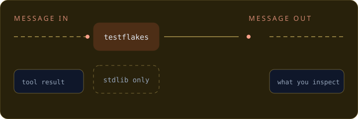

<p align="center">
  
</p>

<p align="center">
  <a href="https://pypi.org/project/testflakes/"></a>
  <a href="https://pypi.org/project/testflakes/"></a>
  <a href="https://pypi.org/project/testflakes/"></a>
  <a href="https://github.com/sandeshbagmare/testflakes/actions/workflows/ci.yml"></a>
  <a href="https://github.com/sandeshbagmare/testflakes/blob/main/LICENSE"></a>
  <a href="https://sandeshbagmare.github.io/testflakes/"></a>
  <a href="https://pypi.org/project/testflakes/"></a>
</p>

<h3 align="center">rank your flaky tests from the history you already have</h3>
<p align="center"><em>Standard library only. No runtime dependencies. Python 3.9+.</em></p>

<p align="center">
  
</p>

## Install

```console
pip install testflakes
```

## Score

For each test it counts **flips**: the times its outcome changed from one run to the
next one it appeared in.

```
score = flips / (runs - 1)
```

- `0.0` — never changed its mind: always passing, or always failing
- `1.0` — alternates every single run
- a test that fails every time scores `0.0` and is *broken*, not flaky, which is why
  the failure count is printed next to the score

A skipped run is dropped from the sequence rather than counted as a change, so a
temporarily disabled test does not look flaky. A test that is missing from a run
(date-filtered, sharded) is skipped too.

## Use

```python
from testflakes import flakiness, newly_failing, parse_runs

runs = parse_runs(["monday.xml", "tuesday.xml", "wednesday.xml"])
for stat in flakiness(runs, min_runs=3)[:10]:
    print(f"{stat.node_id:50} {stat.score:.2f} failures={stat.failures}")

regressions = newly_failing(runs[-2], runs[-1])
```

```console
testflakes reports/*.xml --top 10 --min-runs 5      # the table above
testflakes reports/*.xml --json                      # for a dashboard
testflakes yesterday.xml today.xml --new yesterday   # what broke, exit 1 if anything
```

`--new` is the CI gate: it prints the tests that fail today and were not failing
before, and exits non-zero, so a flaky suite cannot hide a real regression behind a
retry.

## Limits

- It reads reports; it does not run, retry or quarantine anything.
- Order matters: a flip is measured between consecutive reports, so pass them oldest
  first (`reports/*.xml` is already sorted by name if you name them by date).
- A test that is flaky but happens to pass in every collected report scores zero.
  That is a measurement, not a bug: collect more runs (`--min-runs` exists for the
  opposite problem).

## Development

```console
python -m venv .venv
.venv/bin/pip install -e ".[test]"
.venv/bin/pytest
```

## License

MIT.
